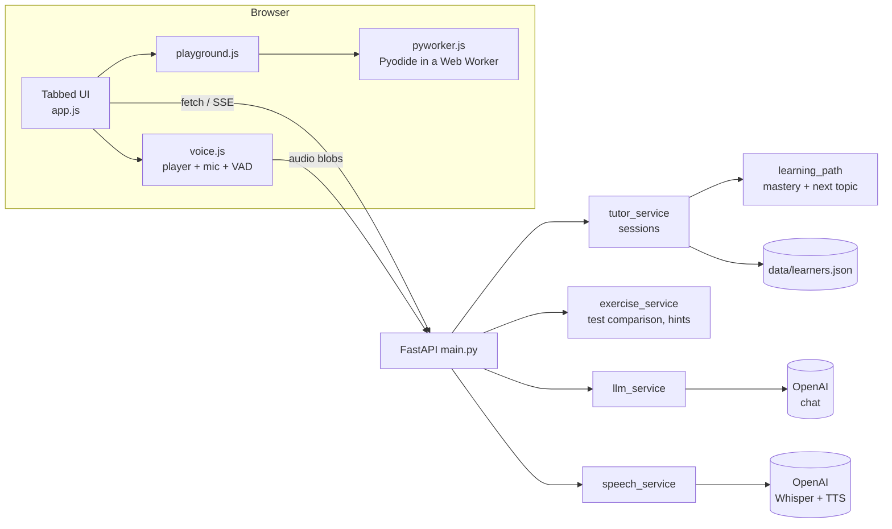

# Maya: AI Python Tutor

A lightweight voice-and-text Python tutor. Maya explains concepts as you watch, speaks to you, listens to you,
lets you run real Python in the browser, checks exercises with actual tests, and adapts what to learn next.

FastAPI + OpenAI on the backend. Plain HTML, CSS and JavaScript on the frontend (no build step, no framework).

> **Screenshots:** add yours to `docs/screenshots/` after your first run and link them here.
> Suggested shots: the Learn tab mid-lesson, the Practice tab with test results, the Playground, the Progress path.

## Features

| Area | What you get |
| --- | --- |
| Lessons | Replies stream in as they are written; Maya starts speaking after the first sentence. "Run this in the playground" button on every code sample. |
| Voice | Speech-to-text (Whisper), text-to-speech (OpenAI TTS) with a voice picker, captions, stop button, automatic end-of-speech detection, hands-free mode and barge-in (talk over Maya to interrupt). |
| Playground | Python runs **in your browser** (Pyodide in a Web Worker). Real output and errors, beginner-friendly error tips, runaway loops stopped after 6 s. Nothing runs on the server. |
| Exercises | Maya writes a function and test cases. Your code is **executed against the tests in the browser**; the server compares actual vs expected values itself. The AI only explains. Three progressive hints, solution unlocks after all hints or three attempts. |
| Adaptive path | 13-topic path. Quiz and exercise results become a mastery score per topic; Maya recommends the next topic (or a review) and makes exercises easier or harder. Progress is saved to a small JSON file. |
| Avatar | Human-style SVG avatar: blinking, breathing, nodding while speaking, tilting while thinking or listening, audio-reactive mouth, live waveform. Respects reduced-motion settings. |
| Interface | Responsive, tabbed (Learn, Practice, Playground, Quiz, Progress), light and dark mode, four text sizes, keyboard friendly. |
| Reliability | Friendly messages for invalid key, rate limit, timeout and network failures. Input validation with Pydantic. Access logging without request bodies. |

## Verification status

I'd rather be upfront about what has and hasn't been tested.

| Checked | How |
| --- | --- |
| Backend logic and API: sessions, streaming parser, exercise validation, server-side test comparison, hint and solution gating, learning-path maths, JSON persistence, error mapping, speech endpoints | 26 automated tests with a mocked OpenAI (`pytest`) |
| Sentence chunking for spoken replies | 5 Node tests (`node --test frontend/tests/chunker.test.mjs`) |
| Real server serves the UI and streams lessons over HTTP | Smoke test with mocked AI |
| JavaScript syntax; every element id used by the code exists in the HTML | Automated check |
| **Not yet verified in a browser or with a real OpenAI key:** Pyodide execution and worker timeout, microphone recording and auto-stop, hands-free and barge-in, streamed UI rendering, TTS playback queue, avatar animation, dark mode | Use `docs/MANUAL_TEST.md` and report anything odd |

## Architecture



**Why it is built this way**
- *Exercises are judged by real code, not by the model.* The browser runs the student's function on each test input and sends the outputs; the server compares them. The LLM only writes friendly feedback and falls back to a plain message if OpenAI is down.
- *Untrusted code never touches the server.* Pyodide runs in a Web Worker that can be terminated if a loop never ends.
- *One streamed format.* Lessons are streamed as plain text with section markers, so the explanation can appear and be spoken immediately while code and expected output are parsed at the end.
- *Lightweight persistence.* One JSON file keyed by learner name, written atomically. No database.

## Project structure

```
backend/   main.py  llm_service.py  tutor_service.py  exercise_service.py
           learning_path.py  storage.py  speech_service.py  errors.py  models.py  avatar_service.py
frontend/  index.html  style.css  js/{app,api,voice,playground,text}.js  js/pyworker.js
tests/     pytest suite (mocked AI)      frontend/tests/  Node tests
docs/      MANUAL_TEST.md  screenshots/  data/  learner progress (git-ignored)
```

## Setup

Requires Python 3.10+ and an OpenAI API key.

```bash
git clone <your-repo> && cd ai-python-tutor
cp .env.example .env              # then edit .env and paste your key
python -m venv .venv && source .venv/bin/activate     # Windows: .venv\Scripts\activate
pip install -r backend/requirements.txt
cd backend && uvicorn main:app --reload
```

Open http://127.0.0.1:8000. Microphone access works on `localhost`. The first time you run Python, the browser
downloads Pyodide (about 10 MB) from the jsDelivr CDN (pinned to v0.26.4), so that step needs internet.

### Environment variables

| Variable | Default | Purpose |
| --- | --- | --- |
| `OPENAI_API_KEY` | none (required) | Your key. Stays on the server and is never sent to the browser. |
| `OPENAI_MODEL` | `gpt-4o-mini` | Chat model for lessons, exercises, quizzes, feedback |
| `OPENAI_TIMEOUT` | `30` | Seconds before an OpenAI call is abandoned (2 automatic retries) |
| `TTS_MODEL` / `TTS_VOICE` | `tts-1` / `nova` | Text-to-speech model and default voice |
| `DATA_DIR` | `./data` | Where `learners.json` is stored |
| `LOG_LEVEL` | `INFO` | Logging verbosity |

## Demo workflow (about 3 minutes)

1. Enter a name, choose **Loops**, press **Start lesson**. Maya's explanation streams in and she starts speaking.
2. Press **Run this in the playground** on the code sample and see the real output.
3. Change the code to cause an error (for example, a typo in a variable name) and read the plain-language tip.
4. Open **Practice**, press **New exercise**, write the function and press **Run tests**. Compare expected and actual output, then ask for a hint.
5. Take the **Quiz**, then open **Progress** to see the mastery bars and Maya's recommended next topic.
6. Turn on **Hands-free conversation**, ask a question out loud, then interrupt her mid-answer.

## Testing

```bash
pip install -r requirements-dev.txt
python -m pytest                                     # backend, mocked AI, no API cost
node --test frontend/tests/chunker.test.mjs          # sentence chunking
```

## API summary

`GET /health`, `GET /speech/voices`, `GET /tutor/progress`, `POST /tutor/start`, `/tutor/topic`, `/tutor/ask`,
`/tutor/ask/stream` (SSE), `/tutor/exercise`, `/tutor/hint`, `/tutor/solution`, `/tutor/evaluate`, `/tutor/quiz`,
`/tutor/quiz/submit`, `/tutor/summary`, `/speech/transcribe`, `/speech/speak`.

## Security and privacy

- `.env` and `data/` are git-ignored; `.env.example` contains only placeholders. Run `git status` before your first commit to confirm no `.env` is staged.
- Student code is never executed on the server and is sent to OpenAI only as text.
- Progress is stored locally by **name only**, with no login, so anyone typing the same name on the same machine sees the same progress. Fine for a local demo; add authentication before hosting this publicly.
- Voice features send your audio and text to OpenAI. Recordings are not saved by this app.
- Browser preferences (theme, text size, voice) use `localStorage`.

## Known limitations

- Exercise tests are written by the model. If a correct solution fails, press **New exercise**. Tests cover pure functions with JSON-friendly inputs and outputs.
- Hands-free works best with headphones; with speakers Maya may hear herself.
- `input()` is not available in the playground.
- Speech-to-text needs a short pause to detect the end of a sentence, and the speech-detection thresholds are simple rather than adaptive to every microphone.
- Lip movement follows loudness, not individual sounds.
- Sessions live in memory (progress is saved, the current conversation is not).

## Ideas for later

Per-sentence audio caching, a streaming transcription mode, learner accounts, exporting progress, more exercise types (output prediction, debugging).
